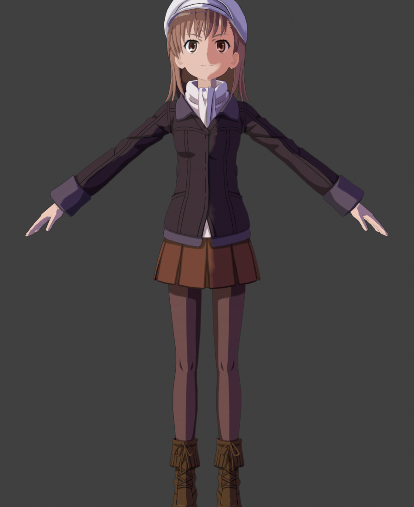
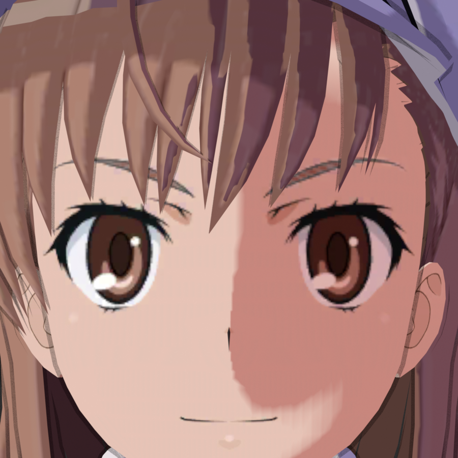

# ToaruIF-BlenderAddon

《魔法禁书目录 幻想收束》（とある魔術の禁書目録 幻想収束，ToaruIF）角色模型的 Blender 插件：
PMX 2.1 降级导入、表情装载、VMD 动作导入，以及参考游戏 shader 与 BV-Toon 的一键卡通渲染。

适用于 Blender 3.6 / 4.x / 5.x（已在 3.6.11 与 5.2 实测），依赖 [mmd_tools](https://github.com/UuuNyaa/blender_mmd_tools)。

## 功能

### 1. 导入模型（PMX）

- 游戏导出的 PMX 是 2.1 版本，`mmd_tools` 只认 2.0。插件内置 PMX 读写模块，先自动降级为 2.0（保留 SoftBody 等全部段落，结果写在源文件同目录、文件名加 `_pmx20`），再调用 `mmd_tools` 导入。
- 导入后自动执行「装载变形（BIND）」，把表情绑到滑杆。
- 游戏用 flip 归纳表情做二值切换，`mmd_tools` 的 group 表情是线性渐变。插件把 flip 转成 group 并追加阶跃驱动（`v >= 0.5` 时才输出原始权重），还原游戏里瞬间切换的行为，保证 VMD 表情动作播出来和实机一致。

### 2. 导入动作（VMD）

- 按当前选区向上找到模型 ROOT 再导入，缩放与模型一致（0.08）。
- 必须先在模型上完成「装载变形」，否则表情轨道会被丢弃。

### 3. 一键卡通渲染

把选中模型的全部材质重建为游戏风格的单色自发光节点图：

- **明暗分界**：取世界法线 → 相机空间，只保留水平分量，按「受光方向」绕竖轴旋转，得到一条竖直条带，再用近似硬边（`分界宽度 0.04`）切成两段。分界与场景灯光无关，转视角不会变成另一种打光。
- **保留 `_mask` 逻辑**：`_mask` 的绿通道以 0.5 为中性推动分界（美术画出的亮/暗岛），蓝通道叠加高光，强度对应游戏材质的 `_ToonShadeMask = 0.35`。
- **暗部色**：按部位（脸 / 头发 / 身体）乘以分区暗部色，在线性空间校准，脸偏粉、头发偏紫、衣物偏冷。
- **描边**：调用 `mmd_tools` 的 `edge_preview_setup`，每个材质一个反向外壳，厚度约 1.8mm，颜色对齐游戏 `_OutlineColor` 的暖褐色 (0.208, 0.114, 0.0)；眼、瞳、眉、口、睫等材质会把外壳顶点权重清零，不会出现黑边糊住眼睛。`mmd_tools` 不可用时退回插件自建外壳。
- 同时把场景切到 Eevee + Standard 视图变换，并准备世界环境、主光与全身相机。

可选参数（F9 面板）：

| 参数 | 默认 | 说明 |
| --- | --- | --- |
| 添加描边 | 开 | 关闭则移除 `mmd_tools` 边缘预览与自建外壳 |
| 描边宽度 | 0.0018 m | 1.8mm 约等于正常构图下的 1–2 像素 |
| 描边颜色 | (0.208, 0.114, 0.0) | 游戏 `_OutlineColor` |
| 受光方向 | 0.42 | 明暗分界绕竖轴旋转，与 BV-Toon 预设一致 |
| 分界位置 | 0.05 | 越小阴影面积越大；用于把分界停在可见曲面上 |
| 分界宽度 | 0.04 | 越小越接近硬两段 |
| 遮罩强度 | 0.35 | 对应 `_ToonShadeMask` |
| 边缘光强度 | 0.0 | 对应 `_RimScale`，游戏出厂为 0，运行时才上调 |

## 安装

1. 在 Blender 的「编辑 → 偏好设置 → 插件 / 扩展」里安装并启用 **mmd_tools**。
2. 安装本插件：选择 [toaruif_tools.zip](toaruif_tools.zip)，或直接把 `toaruif_tools` 文件夹放进 `scripts/addons/`。
3. 启用后在 3D 视图侧栏的「幻想收束」面板中使用。

## 使用流程

1. 侧栏点击「导入模型 (PMX)」，选择游戏导出的 PMX。
2. 需要动作时先选中模型或骨架，再点「导入动作 (VMD)」。
3. 选中模型（或骨架、网格），点「一键卡通渲染」。

## 预览

| 全身 | 头部特写 |
| --- | --- |
|  |  |

## 已知限制

- 分界线由相机空间法线决定，属于固定的美术打光，不跟随场景灯光变化。
- 描边依赖 `mmd_tools`；没有它时使用插件自建外壳，效果略逊。
- 插件面向《幻想收束》导出的角色模型，其他来源的 PMX 未做验证。
- 源模型贴图缺失时，`_mask` 会退回中性 4×4 遮罩，此时只有条带明暗、没有遮罩细节。

## 致谢与声明

- 光影与描边思路参考 **BV-Toon**（BVan）插件的相机空间条带与 `mmd_tools` 边缘预览方案。
- 材质参数取自《幻想收束》IL2CPP dump 与 AssetBundle 内的实际材质（`_LambertOffset`、`_ToonShadeMask`、`_RimScale`、`_OutlineColor` 等）。
- **魔法禁书目录 幻想収束** 版权归 `株式会社KADOKAWA / 株式会社スクウェア・エニックス` 等权利方所有，本项目仅用于模型处理与学习交流。
- 本项目以 GPL-3.0 发布，见 [LICENSE.txt](LICENSE.txt)。
